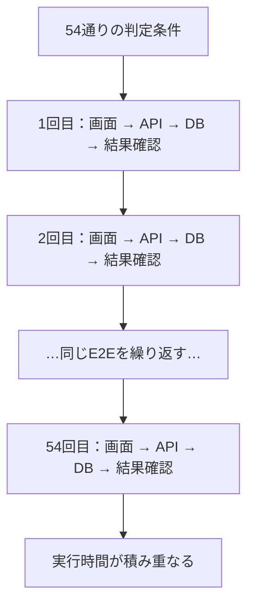
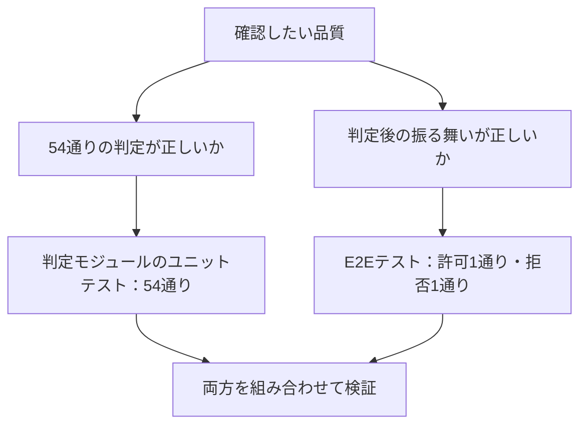

AI開発では「E2Eテストを厚くすべき」という議論があります。しかし、必要なテストはシステムによって違います。

例えば、54通りの権限判定をすべてE2Eで確認するのは負荷が大きいでしょう。しかし、**判定の正しさ**と**判定結果に応じた振る舞い**を分ければ、必要な品質をもっと効率よく確かめられます。

問題は、どのテストを厚くするかよりも、**システム全体をどう検証するかを、実装前に考えているか**です。

**あらかじめ、どうテストするかを考えてから設計・実装する。**

ここでいう「先に」は、テストコードを先に書くという意味ではありません。システム全体の検証方法を見渡し、**テスト可能なモジュール構造を実装前に設計する**という意味です。


## 1. システム全体の検証から、構造を考える

最初に、画面操作、業務ルール、外部連携など、**システム全体で何を確認すべきか**を整理します。

次に、テストケース・組み合わせ・期待結果を設計し、実行時間やデータ準備の負荷を考慮して検証方法を選びます。

ここで大量のケースを直接テストする必要が分かれば、**その処理をどこで分離し、どんな入力と出力を持たせるか**まで決めておきます。すべてを分割するのではなく、必要な境界を設計します。


このフローの終点は**設計完了**です。実装とテストの実行は、その後に行います。

## 2. 具体例：54ケースから何が分かるか

タスク管理システムの、ログイン済みユーザーに対する操作権限を考えます。

| 操作 | 許可条件 |
|---|---|
| 閲覧 | 全ユーザー |
| 編集 | 完了前で、管理者または担当者本人の一般ユーザー |
| 削除 | 管理者で、タスクが未着手 |

テストケースを作るため、4つの因子を洗い出します。

| 因子 | 水準 |
|---|---|
| 権限 | 管理者／一般／閲覧専用 |
| 操作 | 閲覧／編集／削除 |
| タスク状態 | 未着手／進行中／完了 |
| 担当者本人 | はい／いいえ |

**3 × 3 × 3 × 2 = 54ケース**です。期待結果は、実装コードではなく上記の仕様から定義します。これは**選んだ4因子の全組み合わせ**であり、システム全体の網羅を意味しません。

さて、この54通りをすべてE2Eテストで検証する必要があるでしょうか。

画面から操作し、APIやDBまで通して結果を確かめるE2Eは、実行に時間がかかります。54通りを毎回確認するのは負担です。



ただし、54通りで網羅したいのは**権限判定の正しさ**です。一方、E2Eで確認したいのは、判定結果に応じたシステムの振る舞いです。

そこで、検証を分担します。

| 確認したいこと | テスト方法 | ケース数 |
|---|---|---:|
| 54通りの条件で判定が正しいか | 判定モジュールのユニットテスト | **54** |
| 許可・拒否の結果に応じて正しく振る舞うか | E2Eテスト | **2（許可・拒否）** |



E2Eでは、例えば次の代表パターンを確認します。

| 判定結果 | 代表パターン | E2Eで確認すること |
|---|---|---|
| 許可 | 担当者本人の一般ユーザーが進行中タスクを編集 | 更新に成功し、DBに反映される |
| 拒否 | 担当者ではない一般ユーザーが進行中タスクを編集 | 更新が拒否され、DBは変更されない |

つまり、**判定は54通り網羅し、E2Eでは許可・拒否の振る舞いを1ケースずつ確認する**という考え方です。

このテストを実現するために、権限判定を単独で呼び出せるモジュールとして分離します。

## 3. テストケースがモジュール構造を変える

権限判定が `TaskService` の内部に埋もれていると、54通りの判定だけを直接テストしにくくなります。

そこで、実装前に判定専用の `PermissionPolicy` を設計します。**判定だけを高速に網羅できる境界**を作るわけです。


テストで洗い出した**4因子を入力の4項目**に、許可・拒否の**期待結果を戻り値**に対応させます。DBから値を取得する責務は `TaskService` に残し、判定は副作用のない純粋関数とします。

```ts
// permission-policy.ts
export type Input = {
  role: 'admin' | 'member' | 'viewer'
  action: 'view' | 'edit' | 'delete'
  status: 'todo' | 'doing' | 'done'
  isAssignee: boolean
}

export function canOperate(x: Input): boolean {
  if (!['admin', 'member', 'viewer'].includes(x.role)) return false
  if (!['todo', 'doing', 'done'].includes(x.status)) return false

  if (x.action === 'view') return true
  if (x.action === 'edit')
    return x.status !== 'done' &&
      (x.role === 'admin' || (x.role === 'member' && x.isAssignee === true))
  if (x.action === 'delete')
    return x.role === 'admin' && x.status === 'todo'
  return false
}
```

未定義の操作や権限は拒否するようにし、ロールや担当者情報は認証済みのサーバー側データから渡します。TypeScriptの型だけでは実行時の入力値を保証できません。

この関数なら、仕様から作った期待結果と戻り値を直接照合できます。

```ts
import assert from 'node:assert/strict'
import { canOperate } from './permission-policy.ts'
import { testCases } from './test-cases.mjs'

for (const { expected, ...input } of testCases) {
  assert.equal(canOperate(input), expected)
}
```

これで判定モジュールは54ケースを高速に検証できます。

一方、E2Eでは**許可された場合に操作できること**と、**拒否された場合に操作できないこと**を、それぞれ代表的な1ケースで確認します。判定結果が画面・APIの振る舞いにつながっていることを確かめます。

もちろん、閲覧・編集・削除などで固有の処理がある場合は、その振る舞いも別途検証します。

重要なのは、**54通りをE2Eで繰り返す代わりに、判定の網羅と結果に応じた振る舞いの検証を組み合わせる**ことです。

[54ケースの期待結果とテストコード](https://github.com/tamutamu/zenn-articles/blob/main/examples/ai-era-e2e-module-test-design/test-cases.mjs)も確認できます。

## 4. テスト可能性は、システム設計で作り込む

この話は、テストコードと実装コードをどちらから書くか、という開発手順の話ではありません。

**システム全体のテスト設計を先に行い、必要な検証を無理なく実行できるアーキテクチャにしておく**という話です。

すべてE2Eで検証できるなら、そのためにモジュールを増やす必要はありません。大量の条件を直接検証する必要があれば、適切な境界を設けます。

**どうテストするかを考えてから、設計・実装する。** 最初からテスト可能なシステムを作ることが狙いです。もちろん、仕様や検証条件が変われば設計も見直します。