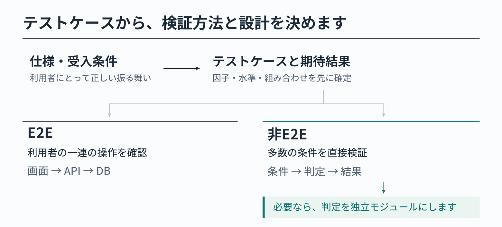

AIを使った開発では、「E2Eテストを厚くする」という考え方を見かけます。実際の画面から操作し、APIやDBまで含めて確認できるE2Eは、確かに有効です。

**では、条件の組み合わせが多い処理まで、すべてE2Eで確認するのがよいのでしょうか。**

AIはテストコードを大量に生成できます。しかし、件数が増えても、期待結果の誤りや検証条件の抜けが解消されるわけではありません。

この記事では、仕様からテストケースを先に設計し、E2Eと非E2Eに配分した結果をモジュール設計に反映する方法を、簡単な例で紹介します。



## 1. E2Eを増やす前に、テストケースを決めます

まず、利用者の操作と受入条件から、入力条件・組み合わせ・期待結果を整理します。そのうえで、テストの役割を分けます。

- E2E：画面からの操作、APIとの連携、DBへの反映など、一連の振る舞いを確認します。
- 非E2E：条件の組み合わせが多い判定や計算を、処理に直接入力して確認します。

例えば、権限判定を54通り確認するために、毎回ユーザーやタスクを用意して画面を操作するのは手間がかかります。判定を直接呼べれば、同じ54通りを少ない準備で検証できます。

そのための入口が既にあれば、そのまま使います。なければ、テストケースを直接検証できるようにモジュールの境界を設計します。

## 2. 具体例：タスクの操作権限

タスク管理システムで、ログイン済みユーザーの閲覧・編集・削除を考えます。

仕様は次の3つです。

- 閲覧：どのユーザーでも閲覧できます。
- 編集：管理者、または担当者本人の一般ユーザーが編集できます。ただし、完了済みは編集できません。
- 削除：管理者だけが未着手のタスクを削除できます。

### テストケースを洗い出します

| 因子 | 水準 |
|---|---|
| 権限 | 管理者／一般／閲覧専用 |
| 操作 | 閲覧／編集／削除 |
| 状態 | 未着手／進行中／完了 |
| 担当者本人 | はい／いいえ |

**3 × 3 × 3 × 2 = 54通り**です。仕様から各ケースの期待結果を決めると、次の内訳になります。

| 操作 | 許可する条件 | 許可 | 拒否 |
|---|---|---:|---:|
| 閲覧 | すべて | 18 | 0 |
| 編集 | 完了前、かつ管理者または担当者本人の一般ユーザー | 6 | 12 |
| 削除 | 管理者、かつ未着手 | 2 | 16 |
| 合計 | | 26 | 28 |

今回は、この54通りをすべて非E2Eで検証します。E2Eでは、例えば「一般ユーザーが自分のタスクを編集できる」「他人のタスクの編集が拒否される」「管理者が未着手のタスクを削除できる」といった操作を確認します。

## 3. テストケースからモジュールを設計します

権限判定をどこに置くか、2つの設計案を比較します。


案Aでは、権限判定がタスクの操作処理に含まれています。判定を確認するテストも、TaskServiceの操作を経由します。

案Bでは、権限判定を独立した `PermissionPolicy` モジュールにします。TaskServiceからもテストからも、同じ判定を直接呼び出せます。今回は案Bを採用します。

判定は短い関数として実装できます。

```ts
// permission-policy.ts
export type Input = {
  role: 'admin' | 'member' | 'viewer'
  action: 'view' | 'edit' | 'delete'
  status: 'todo' | 'doing' | 'done'
  isAssignee: boolean
}

export function canOperate(x: Input): boolean {
  if (x.action === 'view') return true
  if (x.action === 'delete')
    return x.role === 'admin' && x.status === 'todo'
  return x.status !== 'done' &&
    (x.role === 'admin' || (x.role === 'member' && x.isAssignee))
}
```

`canOperate()` は、4つの条件を受け取り、許可なら `true`、拒否なら `false` を返します。DB操作は行いません。

非E2Eテストでは、仕様から決めた期待結果と直接比較できます。

```ts
import assert from 'node:assert/strict'
import { canOperate } from './permission-policy.ts'

const input = {
  role: 'member', action: 'edit',
  status: 'doing', isAssignee: true,
} as const

assert.equal(canOperate(input), true)
assert.equal(canOperate({ ...input, isAssignee: false }), false)
```

これは2ケースの抜粋です。[54通りすべてのテストコード](https://github.com/tamutamu/zenn-articles/blob/main/examples/ai-era-e2e-module-test-design/permission-policy.test.mjs) では、入力条件と期待結果を表で定義し、全件を実行します。

実際のタスク操作では、TaskServiceが認証済みユーザーとDBから取得したタスクの状態を `canOperate()` に渡し、許可された場合だけDBを操作します。この接続が正しく動くことはE2Eで確認します。

---

E2Eは、画面からの一連の操作を確かめるために欠かせません。一方、すべての条件を画面から検証する必要はありません。

**先にテストケースを決め、E2Eと非E2Eに配分し、必要なモジュールを設計します。**
