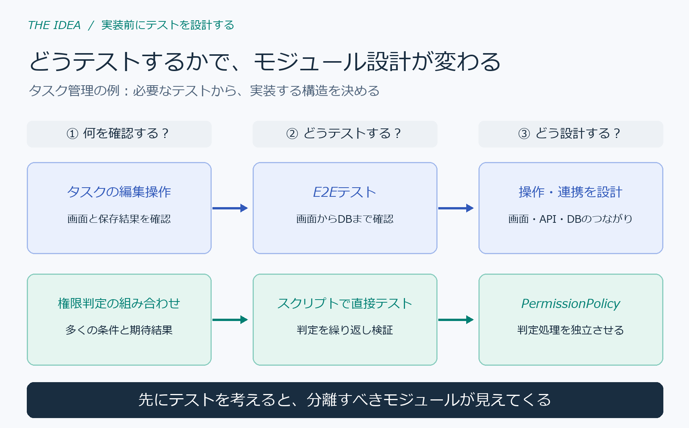
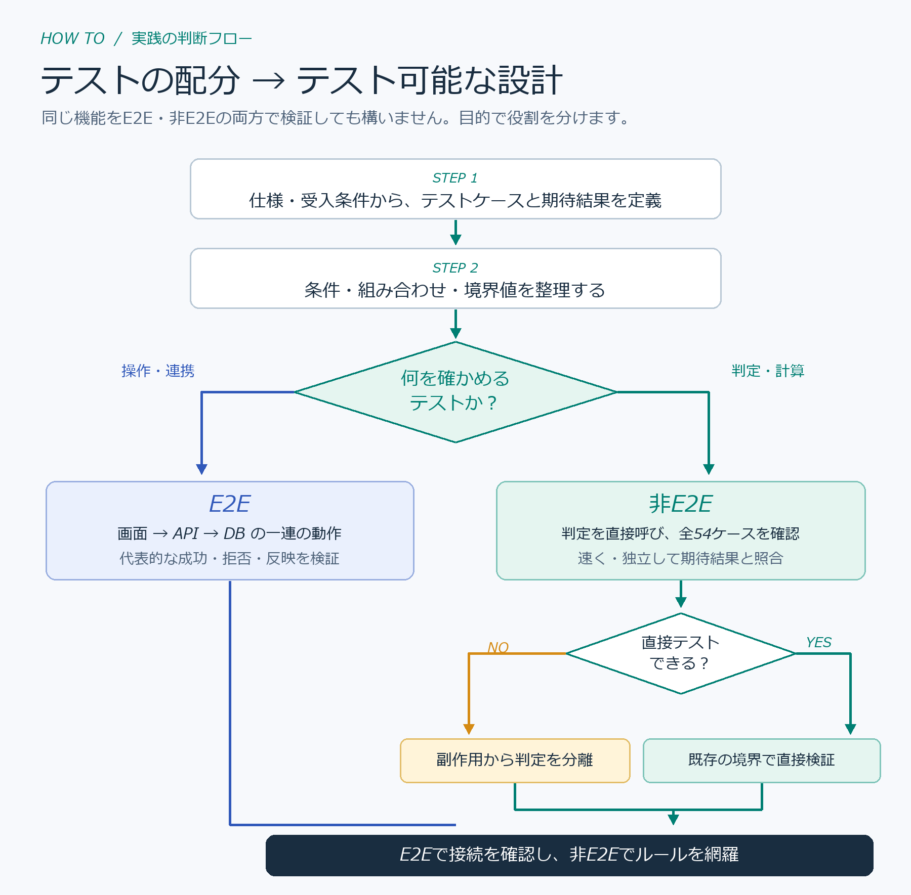
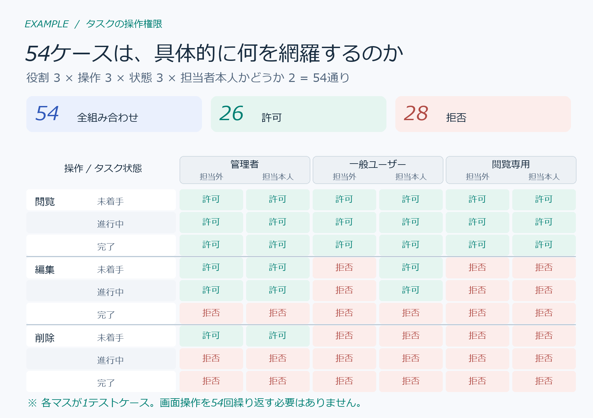
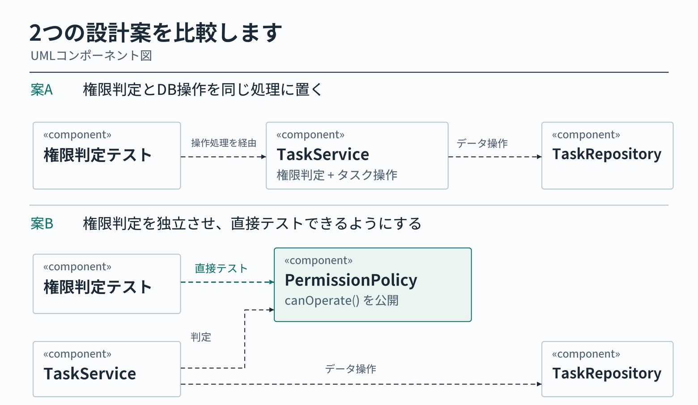

「AI開発ではE2Eテストを厚くすべき」という議論があります。実際に、[E2Eを重視する実践例](https://zenn.dev/sompojapan_dx/articles/7a2de003e25e5f)もあれば、[E2Eに寄せすぎた構成を見直した例](https://zenn.dev/sunagaku/articles/stop-putting-everything-in-e2e)もあります。

どちらが正しいかは、システムによります。E2Eで回せるならE2Eでよく、難しければユニットテストなどを使います。

問題は、どのテストを厚くするかよりも、**システム全体をどう検証するかを、実装前に考えているか**です。

**あらかじめ、どうテストするかを考えてから設計・実装する。**

ここでいう「先に」は、テストコードを先に書くという意味ではありません。システム全体の検証方法を見渡し、**テスト可能なモジュール構造を実装前に設計する**という意味です。



## 1. システム全体の検証から、構造を考える

最初に、画面操作、業務ルール、外部連携など、**システム全体で何を確認すべきか**を整理します。

次に、テストケース・組み合わせ・期待結果を設計し、実行時間やデータ準備の負荷を考慮して検証方法を選びます。

ここで大量のケースを直接テストする必要が分かれば、**その処理をどこで分離し、どんな入力と出力を持たせるか**まで決めておきます。すべてを分割するのではなく、必要な境界を設計します。



このフローの終点は**設計完了**です。実装とテストの実行は、その後に行います。

## 2. 具体例：54ケースから何が分かるか

タスク管理システムの、ログイン済みユーザーに対する操作権限を考えます。

| 操作 | 許可条件 |
|---|---|
| 閲覧 | 全ユーザー |
| 編集 | 完了前で、管理者または担当者本人の一般ユーザー |
| 削除 | 管理者で、タスクが未着手 |

テストケースを作るため、4つの因子を洗い出します。

| 因子 | 水準 |
|---|---|
| 権限 | 管理者／一般／閲覧専用 |
| 操作 | 閲覧／編集／削除 |
| タスク状態 | 未着手／進行中／完了 |
| 担当者本人 | はい／いいえ |

**3 × 3 × 3 × 2 = 54ケース**です。期待結果は、実装コードではなく上記の仕様から定義します。これは**選んだ4因子の全組み合わせ**であり、システム全体の網羅を意味しません。



54ケースなら、すべてE2Eで回せる環境もあります。ここでは、ケース数や実行頻度が増え、判定の全組み合わせを画面から確認する負荷が大きいと仮定します。

| 検証したいこと | テスト方法 | 設計に反映すること |
|---|---|---|
| 編集できる／拒否される／画面に結果が反映される | E2E | 画面・API・DBを通る操作の期待結果 |
| 権限・状態・担当者の各組み合わせで判定が正しい | ユニットテスト | **判定処理を直接呼べる境界** |

この例では、**操作全体の確認と、権限判定の全組み合わせを分けて検証できる構造**が必要だと分かります。これはシステム全体のテスト設計から導いた、一つのモジュール境界です。

## 3. テストケースがモジュール構造を変える

権限判定を `TaskService` のDB操作と一体にすると、判定だけを確認する際にもタスクデータの準備が必要です。

そこで、実装前に判定専用の `PermissionPolicy` を設計します。テストのしやすさだけでなく、**権限判定という責務を独立させることが妥当か**も確認します。



テストで洗い出した**4因子を入力の4項目**に、許可・拒否の**期待結果を戻り値**に対応させます。DBから値を取得する責務は `TaskService` に残し、判定は副作用のない純粋関数とします。

```ts
// permission-policy.ts
export type Input = {
  role: 'admin' | 'member' | 'viewer'
  action: 'view' | 'edit' | 'delete'
  status: 'todo' | 'doing' | 'done'
  isAssignee: boolean
}

export function canOperate(x: Input): boolean {
  if (!['admin', 'member', 'viewer'].includes(x.role)) return false
  if (!['todo', 'doing', 'done'].includes(x.status)) return false

  if (x.action === 'view') return true
  if (x.action === 'edit')
    return x.status !== 'done' &&
      (x.role === 'admin' || (x.role === 'member' && x.isAssignee === true))
  if (x.action === 'delete')
    return x.role === 'admin' && x.status === 'todo'
  return false
}
```

未定義の操作や権限は拒否するようにし、ロールや担当者情報は認証済みのサーバー側データから渡します。TypeScriptの型だけでは実行時の入力値を保証できません。

この関数なら、仕様から作った期待結果と戻り値を直接照合できます。

```ts
import assert from 'node:assert/strict'
import { canOperate } from './permission-policy.ts'
import { testCases } from './test-cases.mjs'

for (const { expected, ...input } of testCases) {
  assert.equal(canOperate(input), expected)
}
```

### 2つの設計を同じケースで比較

模擬Repositoryを使う案Aと、判定関数を直接呼ぶ案Bで、同じ54ケースを実行しました。

| 比較項目 | 案A：サービス内で判定 | 案B：判定を独立 |
|---|---:|---:|
| 合格した判定ケース | 54 | 54 |
| 模擬Repositoryのデータ設定 | 54回 | 0回 |
| 模擬Repositoryの呼び出し | 54回 | 0回 |

表は通常の54ケースについての比較です。**案Bでは判定テストにRepositoryの代替を用意しなくてよい**という構造上の違いを示しています。実際のE2E実行時間や開発工数の短縮を証明するものではありません。

比較に使った[テストコード](https://github.com/tamutamu/zenn-articles/blob/main/examples/ai-era-e2e-module-test-design/design-comparison.test.mjs)と[54ケースの期待結果](https://github.com/tamutamu/zenn-articles/blob/main/examples/ai-era-e2e-module-test-design/test-cases.mjs)も確認できます。

```bash
node --experimental-strip-types --test examples/ai-era-e2e-module-test-design/*.test.mjs
```

なお、副作用のない関数はユニットテストの必須条件ではありません。また、分離した判定が実際の画面操作で正しく使われることは、E2E側で確認する必要があります。

## 4. テスト可能性は、システム設計で作り込む

この話は、テストコードと実装コードをどちらから書くか、という開発手順の話ではありません。

**システム全体のテスト設計を先に行い、必要な検証を無理なく実行できるアーキテクチャにしておく**という話です。

すべてE2Eで検証できるなら、そのためにモジュールを増やす必要はありません。大量の条件を直接検証する必要があれば、適切な境界を設けます。

**どうテストするかを考えてから、設計・実装する。** 最初からテスト可能なシステムを作ることが狙いです。もちろん、仕様や検証条件が変われば設計も見直します。
