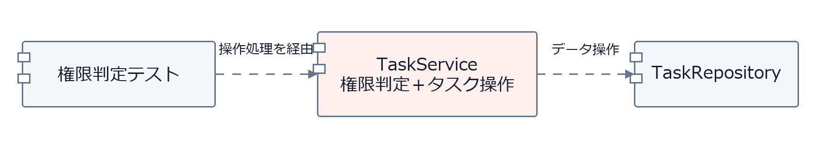
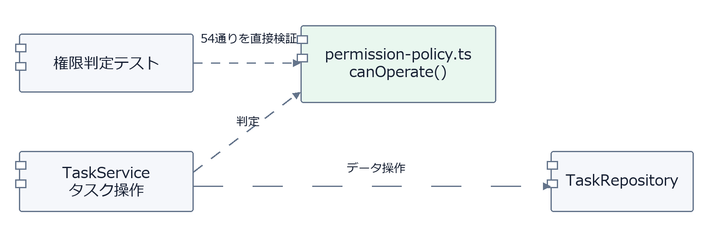

## 1. 問題提起：AIが作ったテストを、どう確かめるか

AIを使うと、実装もユニットテストも短時間で大量に作成できます。一方で、生成されたテストの期待結果が正しいか、必要な条件を網羅できているかを、一件ずつ人が確認するのは大変です。

実装をもとにテストを作る場合、仕様の誤解が実装とテストの両方に入り込むこともあります。

そこで大切になるのが、**テストコードを書く前に、仕様からテストケースと期待結果を決めておくこと**です。

## 2. 考え方：テストケースから設計を考える

次の順序で進めます。

1. 仕様から、入力条件と期待結果を整理します。
2. 利用者の一連の操作は **E2E** で確認します。
3. E2Eですべて試すには負担が大きい条件は、**非E2E** で直接検証します。
4. 直接検証するために必要なら、判定や計算を独立したモジュールとして設計します。

目的は、モジュールを細かく分割することではありません。**必要なテストを無理なく実行できる構造にすること**です。

## 3. 具体例：タスクの操作権限

タスク管理システムで、ログイン済みユーザーがタスクを閲覧・編集・削除する場面を考えてみます。

ルールは次の3つです。

- **閲覧**：どのユーザーでもできます。
- **編集**：管理者、または担当者本人の一般ユーザーができます。ただし、完了済みのタスクは編集できません。
- **削除**：管理者だけが、未着手のタスクを削除できます。

### ① 仕様から54通りのテストケースを作ります

操作の可否を決める条件は、次の4つです。

| 因子 | 水準 |
|---|---|
| ユーザー権限 | 管理者／一般／閲覧専用 |
| 操作 | 閲覧／編集／削除 |
| タスク状態 | 未着手／進行中／完了 |
| 担当者本人 | はい／いいえ |

組み合わせは **3 × 3 × 3 × 2 = 54通り**です。それぞれの期待結果を仕様から決め、54通りすべてを検証します。

| 操作 | 許可する条件 | 許可 | 拒否 |
|---|---|---:|---:|
| 閲覧 | すべての条件 | 18 | 0 |
| 編集 | 完了前で、管理者または担当者本人の一般ユーザー | 6 | 12 |
| 削除 | 管理者、かつ未着手 | 2 | 16 |
| **合計** | | **26** | **28** |

### ② E2Eと非E2Eの役割を分けます

**E2E** では、画面から操作して、APIやDBまで含めた動作を確認します。例えば、一般ユーザーが自分のタスクを編集・保存できること、他人のタスクの編集が拒否されること、管理者が未着手のタスクを削除できることなどです。

**非E2E** では、54通りの権限判定を直接検証します。判定のたびに画面を操作したり、DBのタスクを作り直したりする必要はありません。

### ③ 直接テストできるモジュールを設計します

権限判定をタスク操作処理に含める案と、独立させる案を比べます。

**案A：権限判定をTaskServiceの中に置く**



この案では、権限判定のテストもTaskServiceの操作を通して行います。

**案B：権限判定を独立させる（今回はこちらを採用します）**



通常の処理ではTaskServiceから権限判定を呼び出します。非E2Eテストでは、同じ判定を直接呼び出せます。

権限判定は、次のような短いコードにできます。

```ts
// permission-policy.ts
export type Input = {
  role: 'admin' | 'member' | 'viewer'
  action: 'view' | 'edit' | 'delete'
  status: 'todo' | 'doing' | 'done'
  isAssignee: boolean
}

export function canOperate(x: Input): boolean {
  if (x.action === 'view') return true
  if (x.action === 'delete')
    return x.role === 'admin' && x.status === 'todo'
  return x.status !== 'done' &&
    (x.role === 'admin' || (x.role === 'member' && x.isAssignee))
}
```

`canOperate` は4つの条件を受け取り、操作を許可するときは `true`、拒否するときは `false` を返します。DBへのアクセスは行いません。

実際にタスクを編集する際には、TaskServiceが認証済みユーザーとDBから取得したタスク情報を使って判定します。呼び出し部分を抜粋すると、次のようになります。

```ts
if (!canOperate({
  role: user.role,
  action: 'edit',
  status: task.status,
  isAssignee: task.assigneeId === user.id,
})) throw new Error('権限なし')
```

### ④ 54通りを直接テストします

期待結果は実装から逆算せず、先に決めた**仕様表をテストデータとして使います**。

```js
// permission-policy.test.mjs（54通りを検証するコード）
import { strict as assert } from 'node:assert'
import { test } from 'node:test'
import { canOperate } from './permission-policy.ts'

const statuses = ['todo', 'doing', 'done']
// 各行：権限、操作、未着手・進行中・完了の期待値。
// 2文字は「担当者以外→担当者本人」。1=許可、0=拒否。
const cases = [
  ['admin',  'view',   '11', '11', '11'],
  ['member', 'view',   '11', '11', '11'],
  ['viewer', 'view',   '11', '11', '11'],
  ['admin',  'edit',   '11', '11', '00'],
  ['member', 'edit',   '01', '01', '00'],
  ['viewer', 'edit',   '00', '00', '00'],
  ['admin',  'delete', '11', '00', '00'],
  ['member', 'delete', '00', '00', '00'],
  ['viewer', 'delete', '00', '00', '00'],
]

test('権限判定54通り', () => {
  let count = 0
  for (const [role, action, ...expectedByStatus] of cases)
    for (let s = 0; s < 3; s++)
      for (let a = 0; a < 2; a++) {
        assert.equal(
          canOperate({ role, action, status: statuses[s], isAssignee: a === 1 }),
          expectedByStatus[s][a] === '1',
        )
        count++
      }
  assert.equal(count, 54)
})
```

これで、54通りの権限判定をDBやモックなしで検証できます。一方、実際のAPIが権限判定を呼び出していることや、拒否された操作でDBが変更されないことは、E2Eで確認します。

---

**テストケースを先に整理し、E2Eでは検証しにくい部分を直接テストできるように設計します。** この進め方なら、テストは実装後の確認だけでなく、実装の構造を考える材料にもなります。
